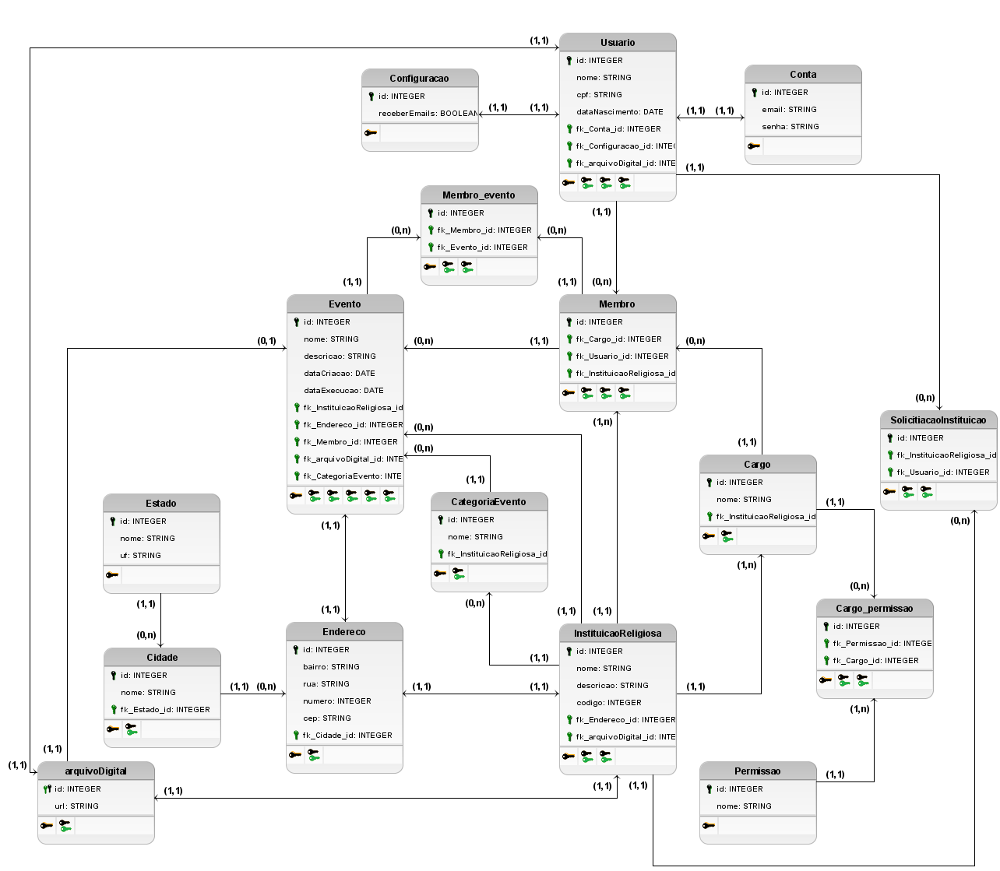
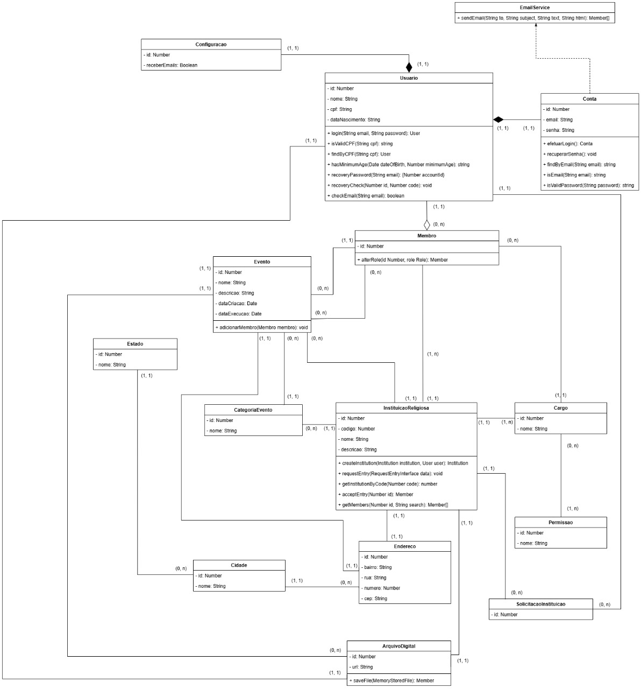
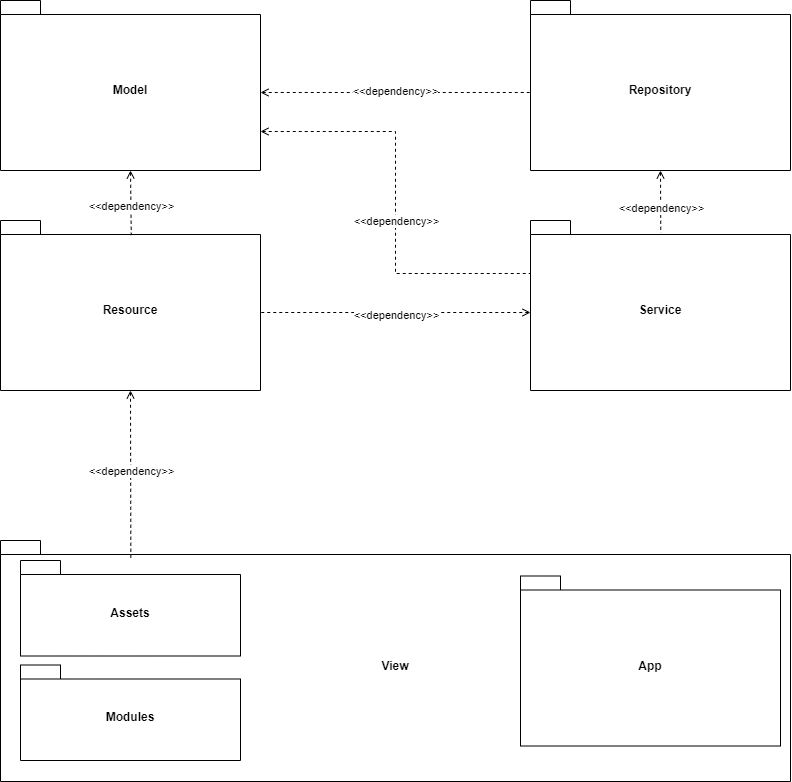
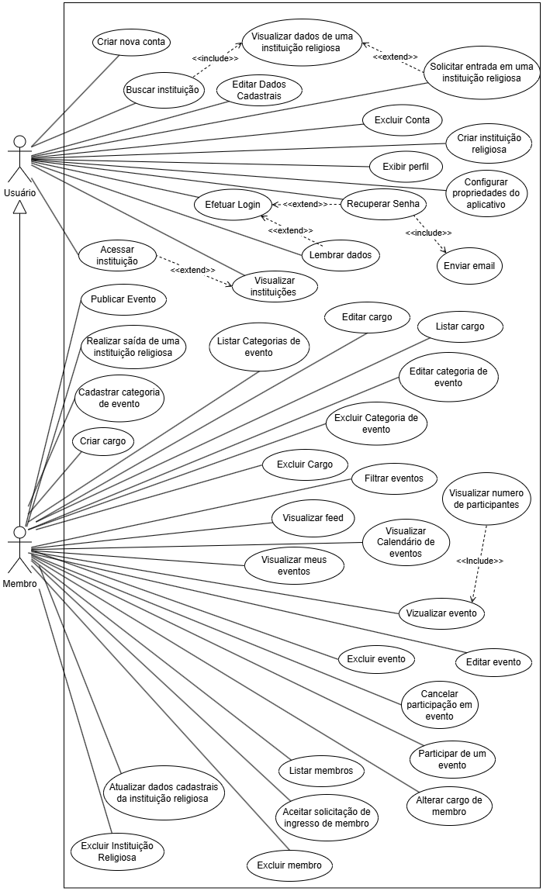
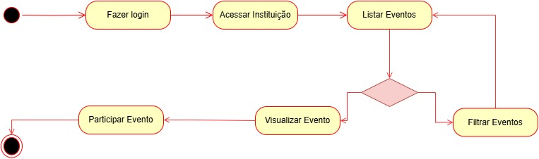

<p align="center">
  
</p>

<h1 align="center">⚙️ Worcher API — Backend & Core Services</h1>

<p align="center">
  <strong>API RESTful modular construída em NestJS, TypeScript e TypeORM com MySQL para suportar a plataforma de gestão de eventos e comunidades religiosas Worcher.</strong>
</p>

<p align="center">
  <a href="https://nestjs.com/"></a>
  <a href="https://www.typescriptlang.org/"></a>
  <a href="https://typeorm.io/"></a>
  <a href="https://www.mysql.com/"></a>
  <a href="https://jestjs.io/"></a>
  <a href="https://pt.scribd.com/document/1012433561/ADS-2024-2-HelenGiovanaDeFariaMarques-DesenvolvimentoDeUmaAplicacaoMobileParaGestaoDeEventosEmInstituicoesReligiosas"></a>
</p>

---

> [!NOTE]
> ### 📱 Aplicativo Mobile (Frontend)
> Esta API foi desenvolvida para atender ao ecossistema do aplicativo mobile **Worcher** (construído em Ionic, React e Capacitor).
> 
> 👉 **[Acessar repositório Worcher_TG (Frontend)](https://github.com/obertobr/Worcher_TG)**

---

## 📌 Sumário

- [Visão Geral](#-visão-geral)
- [Arquitetura & Engenharia de Software](#-arquitetura--engenharia-de-software)
  - [Modelo de Banco de Dados (DER)](#-modelo-de-banco-de-dados-der)
  - [Diagramas Estruturais](#-diagramas-estruturais)
- [Principais Funcionalidades da API](#-principais-funcionalidades-da-api)
- [Stack Tecnológica](#-stack-tecnológica)
- [Estrutura de Pastas](#-estrutura-de-pastas)
- [Referência de Endpoints](#-referência-de-endpoints)
- [Instalação e Execução](#-instalação-e-execução)
  - [Pré-requisitos](#pré-requisitos)
  - [Passo a Passo](#passo-a-passo)
  - [Configuração de Ambiente (.env)](#configuração-de-ambiente-env)
- [Execução de Testes](#-execução-de-testes)
- [Trabalho Acadêmico / TCC](#-trabalho-acadêmico--tcc)
- [Equipe e Autoria](#-equipe-e-autoria)

---

## 📖 Visão Geral

A **Worcher API** é o núcleo de serviços, regras de negócio e persistência de dados da plataforma Worcher. Projetada seguindo as melhores práticas do ecossistema Node.js empresarial, a API oferece alta coesão, baixo acoplamento e separação clara de responsabilidades entre controladores, serviços e repositórios.

Entre suas atribuições essenciais estão:
- **Gerenciamento de Entidades Centrais:** Usuários, congregações/instituições religiosas, eventos e ministérios.
- **Detecção de Conflitos de Agenda:** Validação de sobreposição de datas e horários antes da confirmação de novos eventos.
- **Controle de Acesso Granular (RBAC):** Hierarquia de papéis (*roles*) e permissões para liderança e membros.
- **Seeding Automático de Dados Geográficos:** Importação e persistência automática de estados e municípios do Brasil via CSV no boot da aplicação.
- **Armazenamento de Mídias e Arquivos Digitais:** Manipulação de fotos de perfil, banners de eventos e logotipos institucionais.
- **Rotinas em Background:** Execução periódica de tarefas agendadas via `@nestjs/schedule`.

---

## 🏗️ Arquitetura & Engenharia de Software

### 🗄️ Modelo de Banco de Dados (DER)

O banco de dados relacional foi modelado para garantir integridade referencial, normalização e alta eficiência em consultas de eventos, participantes e relacionamentos comunitários:

<div align="center">
  
  <p><em>Figura: Diagrama Entidade-Relacionamento (DER) da base de dados Worcher.</em></p>
</div>

---

### 📐 Diagramas Estruturais

<div align="center">

| Diagrama de Classes | Diagrama de Pacotes |
| :---: | :---: |
|  |  |

<br/>

| Casos de Uso (UML) | Diagrama de Atividades |
| :---: | :---: |
|  |  |

</div>

---

## ⚡ Principais Funcionalidades da API

- 🔐 **Autenticação e Segurança:** Criptografia de senhas com `bcrypt`, fluxo seguro de login e verificação de recuperação de conta.
- 👥 **Gestão de Membros e Ingresso:** Geração de códigos alfanuméricos de convite por instituição, triagem de solicitações e aprovação de novos membros.
- 🛡️ **Role-Based Access Control (RBAC):** Associação dinâmica de permissões a cargos customizados criados pela instituição religiosa.
- 📅 **Motor de Eventos & Confirmação de Presença (RSVP):** Agendamento de eventos com vínculo a categorias, controle de presença e cancelamento com rastreio de participantes.
- 🖼️ **Manipulação de Mídias (Digital File Service):** Recepção de arquivos via `multipart/form-data` e serviço estático sob a rota `/uploads/`.
- 🌐 **Carga Inicial Automatizada (Data Seeding):** Leitura de `estados.csv`, `municipios.csv` e `permissions.csv` na inicialização do módulo (`onModuleInit`), garantindo base pronta para uso sem comandos manuais de migração.
- 📧 **Serviço de Mensageria de E-mail:** Integração com Nodemailer para notificações de recuperação de senha.

---

## 🛠️ Stack Tecnológica

| Componente | Tecnologia | Papel no Projeto |
| :--- | :--- | :--- |
| **Framework** | [NestJS 10](https://nestjs.com/) | Framework progressivo Node.js com arquitetura modular baseada em TypeScript |
| **Linguagem** | [TypeScript 5](https://www.typescriptlang.org/) | Tipagem estática, interfaces e decorators nativos |
| **ORM** | [TypeORM 0.3](https://typeorm.io/) | Mapeamento Objeto-Relacional, migração e manipulação de entidades |
| **Banco de Dados** | [MySQL 8](https://www.mysql.com/) / `mysql2` | Armazenamento relacional e integridade de dados |
| **Segurança** | [bcrypt](https://github.com/kelektiv/node.bcrypt.js) | Hash criptográfico unidirecional de senhas com salt |
| **Validação** | `class-validator` / `class-transformer` | Validação e sanitização automática de DTOs e payloads |
| **Uploads** | `nestjs-form-data` | Suporte robusto a payloads multipart/form-data e parsing de imagens |
| **Agendador** | `@nestjs/schedule` | Cron jobs para tarefas periódicas em background |
| **E-mail** | [Nodemailer](https://nodemailer.com/) | Envio de mensagens transacionais via SMTP |
| **Testes** | Jest & Supertest | Suíte de testes automatizados unitários e de integração (E2E) |

---

## 📁 Estrutura de Pastas

```plaintext
Worcher_TG_API/
├── csv_arquives/            # Arquivos CSV para Data Seeding na inicialização
│   ├── estados.csv          # Estados do Brasil (IBGE)
│   ├── municipios.csv       # Municípios do Brasil (IBGE)
│   └── permissions.csv      # Matriz inicial de permissões do sistema
├── docs/
│   └── diagrams/            # Diagramas arquiteturais (DER, Classes, Pacotes, Casos de Uso)
├── src/
│   ├── Controller/          # Camada de entrada HTTP / Rotas REST
│   │   ├── Address/         # Estados, cidades e endereços
│   │   ├── Event/           # Eventos e categorias
│   │   ├── Institution/     # Instituições, cargos e permissões
│   │   ├── response/        # Interceptores de resposta e tratamento de exceção
│   │   └── User/            # Usuários, contas, membros e recuperação
│   ├── Model/               # Entidades TypeORM e classes de domínio
│   │   ├── Address/
│   │   ├── DigitalFile/
│   │   ├── Event/
│   │   ├── Institution/
│   │   ├── Recovery/
│   │   └── User/
│   ├── Repository/          # Camada de acesso a dados e abstrações TypeORM
│   ├── Service/             # Regras de negócio da aplicação
│   │   └── Implemetation/   # Serviços concretos (User, Event, Institution, Email, Csv...)
│   ├── app.module.ts        # Módulo raiz e inicializador do Data Seeding
│   └── main.ts              # Ponto de entrada, configuração de CORS, pipes e uploads
├── test/                    # Testes de integração End-to-End (E2E)
├── uploads/                 # Diretório de armazenamento físico de arquivos e imagens
├── nest-cli.json            # Configurações do CLI NestJS
├── tsconfig.json            # Configurações do compilador TypeScript
└── package.json             # Dependências e scripts
```

---

## 🔌 Referência de Endpoints

A API expõe rotas RESTful organizadas por domínio. Abaixo estão os principais recursos disponíveis:

### 👤 Usuários e Autenticação (`/user` & `/account`)
| Método | Endpoint | Descrição |
| :--- | :--- | :--- |
| `POST` | `/user/login` | Realiza autenticação com e-mail e senha |
| `POST` | `/user` | Cadastra novo usuário na plataforma |
| `GET` | `/user/list` | Lista usuários cadastrados |
| `GET` | `/user/id/:id` | Retorna os detalhes de um usuário específico |
| `POST` | `/user/setPhoto` | Atualiza a foto de perfil do usuário |
| `POST` | `/user/recovery_password` | Dispara e-mail com código de recuperação |
| `POST` | `/user/recovery_check` | Valida código de verificação para troca de senha |

### 🏛️ Instituições Religiosas (`/institution`)
| Método | Endpoint | Descrição |
| :--- | :--- | :--- |
| `POST` | `/institution` | Cadastra nova instituição religiosa (com upload de logo) |
| `PUT` | `/institution` | Atualiza os dados da instituição |
| `GET` | `/institution/id/:id` | Obtém dados completos do perfil da instituição |
| `GET` | `/institution/listByUser/:idUser` | Lista congregações das quais o usuário participa |
| `GET` | `/institution/getInstitutionByCode/:code` | Busca instituição através do código de acesso |
| `POST` | `/institution/requestEntry` | Envia solicitação para ingressar em uma comunidade |
| `GET` | `/institution/acceptEntry/:id` | Liderança aprova solicitação de entrada de membro |
| `GET` | `/institution/getMembers/:id` | Lista membros vinculados à instituição |
| `DELETE`| `/institution/deleteMembershipRequest/:id`| Recusa solicitação de ingresso |

### 📅 Eventos & Presença (`/event` & `/event-category`)
| Método | Endpoint | Descrição |
| :--- | :--- | :--- |
| `POST` | `/event` | Cria um novo evento (com verificação anti-colisão e imagem) |
| `PUT` | `/event` | Atualiza os detalhes de um evento |
| `DELETE`| `/event/:id` | Remove um evento do sistema |
| `GET` | `/event/getEventByInstitutionAndCategory/:idInstitution/:idCategory/:removePast` | Feed filtrado de eventos ativos |
| `GET` | `/event/eventsByIdUser/:userId` | Retorna lista de eventos nos quais o usuário confirmou presença |
| `GET` | `/event/addMemberToEvent/:eventId/:memberId` | Confirma presença do membro no evento (RSVP) |
| `GET` | `/event/removeMemberFromEvent/:eventId/:memberId` | Cancela presença do membro no evento |
| `POST` | `/event-category` | Cria uma categoria de evento com cor personalizada |
| `GET` | `/event-category/list` | Lista categorias de eventos cadastradas |

### 👥 Membros, Cargos & Permissões (`/member`, `/role`, `/permission`)
| Método | Endpoint | Descrição |
| :--- | :--- | :--- |
| `PUT` | `/member/alterRole/:id` | Altera o cargo/nível de permissão de um membro |
| `GET` | `/member/get-member-by-idInstitution-and-idUser/:idInst/:idUser` | Obtém dados do vínculo membro-instituição |
| `POST` | `/role` | Cadastra um novo cargo institucional |
| `GET` | `/role/list` | Lista cargos disponíveis |
| `GET` | `/permission/list` | Lista matriz de permissões disponíveis |

---

## 💻 Instalação e Execução

### Pré-requisitos
- [Node.js](https://nodejs.org/) (v18.x ou v20.x recomendado)
- [MySQL Server](https://dev.mysql.com/downloads/) (local ou via XAMPP / Docker)
- Gerenciador `npm`

---

### Passo a Passo

#### 1. Clonar o repositório
```bash
git clone https://github.com/obertobr/Worcher_TG_API.git
cd Worcher_TG_API
```

#### 2. Instalar as dependências
```bash
npm install
```

#### 3. Criar a base de dados no MySQL
Conecte-se ao seu servidor MySQL e crie o banco de dados `worcher`:

```sql
CREATE DATABASE IF NOT EXISTS worcher CHARACTER SET utf8mb4 COLLATE utf8mb4_unicode_ci;
```

> **Nota:** As tabelas, índices e relacionamentos serão criados automaticamente pelo TypeORM no primeiro arranque (`synchronize: true`). Além disso, os estados, municípios e permissões serão populados a partir dos CSVs inclusos no projeto.

#### 4. Configurar as variáveis de ambiente (Opcional)
Crie um arquivo `.env` na raiz do projeto caso deseje configurar o envio de e-mails:

```env
EMAIL_PASSWORD=sua_senha_de_aplicativo_gmail
```

#### 5. Iniciar o servidor
```bash
# Modo de desenvolvimento (com Hot Reload)
npm run start:dev

# Modo de produção
npm run build
npm run start:prod
```

O servidor iniciará na porta padrão:
👉 **`http://localhost:3000`**

Arquivos enviados (fotos de perfil, logos, banners) serão servidos estaticamente em:
👉 **`http://localhost:3000/uploads/nome-do-arquivo.ext`**

---

## 🧪 Execução de Testes

```bash
# Executar testes unitários
npm run test

# Executar testes com relatório de cobertura
npm run test:cov

# Executar testes de integração End-to-End
npm run test:e2e
```

---

## 🎓 Trabalho Acadêmico / TCC

Esta API compõe a arquitetura do Trabalho de Graduação desenvolvido na **Faculdade de Tecnologia de Bragança Paulista — Jornalista Omair Fagundes de Oliveira (Fatec)**, no curso de **Análise e Desenvolvimento de Sistemas (ADS)**, concluído em 2024.

- 📑 **Título do Artigo:** *Desenvolvimento de uma Aplicação Mobile para Gestão de Eventos em Instituições Religiosas*
- 🔗 **Artigo Científico Disponível no Scribd:**  
  👉 **[Acessar e Baixar Artigo Completo no Scribd](https://pt.scribd.com/document/1012433561/ADS-2024-2-HelenGiovanaDeFariaMarques-DesenvolvimentoDeUmaAplicacaoMobileParaGestaoDeEventosEmInstituicoesReligiosas)**

---

## 👥 Equipe e Autoria

### Autores:
- **Helen Giovana de Faria Marques** — [helen.marques01@fatec.sp.gov.br](mailto:helen.marques01@fatec.sp.gov.br)
- **Lucas do Prado Ribeiro** — [lucas.ribeiro67@fatec.sp.gov.br](mailto:lucas.ribeiro67@fatec.sp.gov.br)
- **Mateus Júlio Barbosa** — [mateus.barbosa13@fatec.sp.gov.br](mailto:mateus.barbosa13@fatec.sp.gov.br)
- **Rafael Eduardo Azzi Lopes** — [rafael.lopes29@fatec.sp.gov.br](mailto:rafael.lopes29@fatec.sp.gov.br)
- **Vinicius Alexandrino de Moraes** — [vinicius.moraes22@fatec.sp.gov.br](mailto:vinicius.moraes22@fatec.sp.gov.br)

### Orientadores:
- **Profa. Dra. Patricia Klinkerfus de Campos** — [patricia.klinkerfus@fatec.sp.gov.br](mailto:patricia.klinkerfus@fatec.sp.gov.br)
- **Prof. Me. Paulo Henrique Leme Ramalho** — [paulo.ramalho@fatec.sp.gov.br](mailto:paulo.ramalho@fatec.sp.gov.br)

---

<p align="center">
  Worcher API — Sustentando conexões comunitárias com robustez e tecnologia. ⛪🚀
</p>
